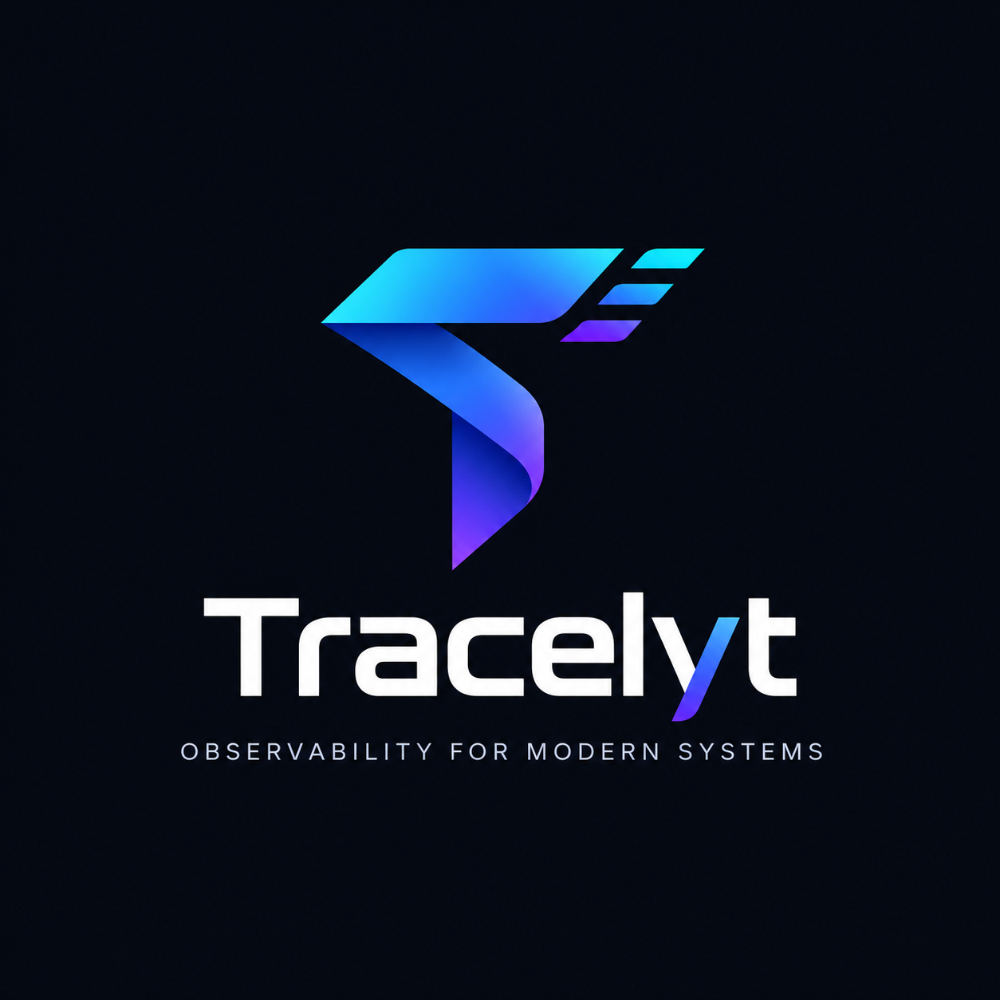
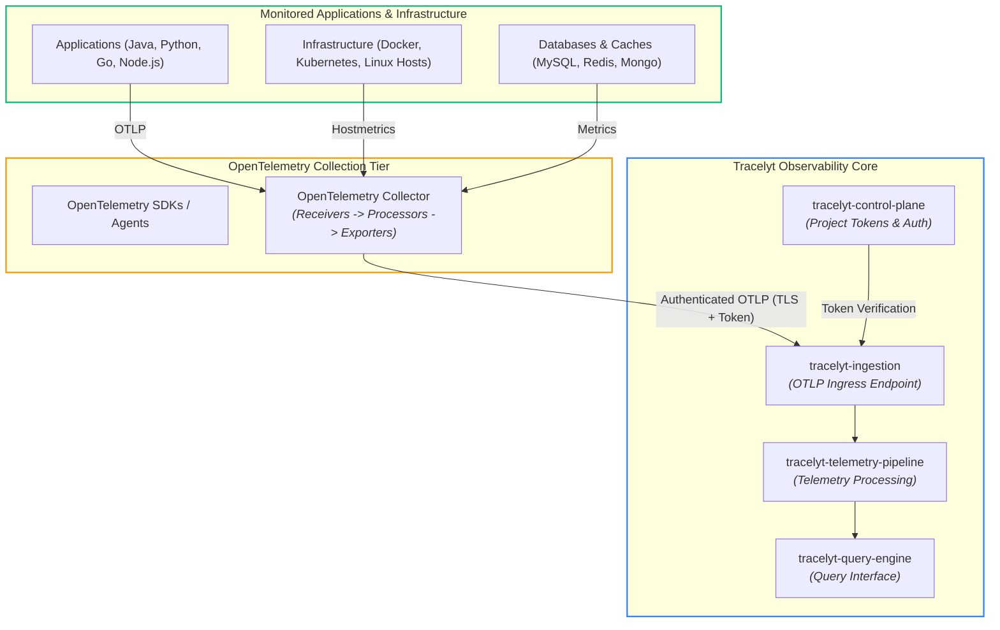
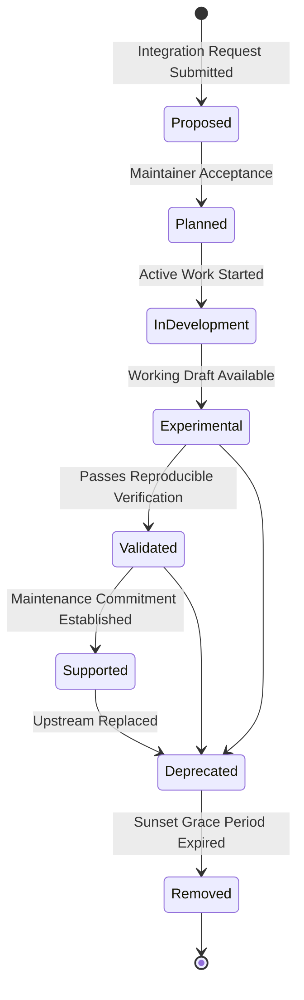

<p align="center">
  
</p>

# Tracelyt Integrations (`tracelyt-integrations`)

[](https://github.com/Tracelyt-Systems/tracelyt-integrations/actions/workflows/ci.yml)
[](https://github.com/Tracelyt-Systems/tracelyt-integrations/actions/workflows/documentation-check.yml)
[](LICENSE)
[](https://opentelemetry.io/)

**Tracelyt Integrations** is the integration guidance, compatibility catalog, and collector configuration repository of **Tracelyt**, an open-source observability platform.

This repository provides developers and platform engineers with verified instructions, architecture guides, and OpenTelemetry Collector configurations for connecting external applications, databases, message brokers, and cloud infrastructure into Tracelyt.

---

> ### ⚠️ CURRENT DEVELOPMENT STATUS: REPOSITORY FOUNDATION & STANDARDS ONLY
> 
> This repository is currently in **Phase 1 (Repository Foundation & Integration Standards Setup)**.
> - **Included**: Project layout, architectural specifications, OpenTelemetry standards, integration lifecycle governance, guide templates, security policies, and CI documentation validation.
> - **NOT Implemented**: No production instrumentation packages, custom agents, exporters, receivers, database connectors, or sample applications are implemented in this phase.
> - All referenced framework guides and collector pipelines represent **planned future integrations**.

---

## 1. Purpose & Relationship with the Tracelyt Ecosystem

Tracelyt is engineered as a decoupled, multi-service observability platform. `tracelyt-integrations` serves as the **interoperability bridge**, defining how external workloads export telemetry into the platform:



### Platform Responsibility Boundaries

| Platform Service | Service Owns | Integrations Repository Does NOT Own |
| :--- | :--- | :--- |
| **`tracelyt-control-plane`** | Organizations, projects, users, authentication, authorization, and project token management. | Does not issue tokens, manage user accounts, or store organization memberships. |
| **`tracelyt-ingestion`** | Receiving telemetry over OTLP, admission control, payload validation, and rate limiting. | Does not implement telemetry receivers or ingestion endpoints. |
| **`tracelyt-specs`** | Authoritative source of truth for shared API contracts, event envelopes, and schema governance. | Does not independently invent custom Tracelyt wire protocols or conflicting schemas. |
| **`tracelyt-telemetry-pipeline`**| Batching, enrichment, filtering, aggregation, and routing of telemetry streams. | Does not replace or replicate backend stream processing pipelines. |
| **`tracelyt-query-engine`** | Querying telemetry storage, computing metric aggregations, and trace retrieval. | Does not query telemetry storage clusters directly. |
| **`tracelyt-alerting`** | Alert rule definitions, condition evaluations, and incident lifecycles. | Does not evaluate alert conditions or manage incident state. |
| **`tracelyt-notifications`** | Delivering alert and incident messages via email, Slack, Teams, Discord, and webhooks. | Does not deliver end-user notification messages. |
| **`tracelyt-deploy`** | Helm charts, Kubernetes operators, Docker Compose, and platform deployment orchestration. | Does not maintain platform-wide deployment infrastructure. |

For detailed boundary definitions, see [System Boundaries](docs/architecture/system-boundaries.md).

---

## 2. OpenTelemetry-First Strategy

Tracelyt standardizes natively on the CNCF [OpenTelemetry](https://opentelemetry.io/) project rather than building proprietary agents or protocols:
- **Zero Proprietary Agent Lock-In**: Workloads export standard **OTLP/gRPC** (port 4317) or **OTLP/HTTP** (port 4318).
- **Semantic Conventions**: Standardized attributes for HTTP (`http.request.method`, `url.path`), databases (`db.system`, `db.operation.name`), and resources (`service.name`, `deployment.environment.name`).
- **Distributed Context Propagation**: W3C Trace Context (`traceparent`, `tracestate`) enforced across distributed boundaries.

Read [OpenTelemetry Strategy](docs/architecture/opentelemetry-strategy.md) and [Collector Architecture](docs/architecture/collector-architecture.md).

---

## 3. Integration Categories

Future integration guides are structured into six distinct categories:

1. **Languages & Runtimes**: Java, Python, Go, Node.js, and .NET runtime guidance.
2. **Frameworks**: Spring Boot, FastAPI, Django, Express.js, NestJS, and ASP.NET Core.
3. **Infrastructure**: Docker daemon, Kubernetes DaemonSet, Linux hosts, and virtual machines.
4. **Databases & Caches**: MySQL, MongoDB, and Redis client and host monitoring.
5. **Message Brokers**: Apache Kafka and RabbitMQ distributed trace context propagation.
6. **Cloud Providers**: AWS, Microsoft Azure, and Google Cloud Platform telemetry connectors.

See [Integration Categories](docs/architecture/integration-categories.md) for category breakdowns.

---

## 4. Integration Lifecycle & Maturity Model

To ensure transparency and prevent unverified support claims, every integration tracks its status across eight explicit lifecycle stages:



- **Truth in Testing**: No integration may be marked `Validated` or `Supported` without documented, reproducible test evidence.
- Review [Integration Lifecycle](docs/standards/integration-lifecycle.md) and [Compatibility Policy](docs/standards/compatibility-policy.md).

---

## 5. Security & Privacy Architecture

Integration configurations handle sensitive infrastructure endpoints and credentials:
- **Zero Hardcoded Secrets**: All credentials must use environment variable expansion (`${env:TRACELYT_TOKEN}`).
- **Mandatory TLS**: External telemetry egress requires TLS 1.2/1.3. Certificate verification is strictly enforced.
- **Least Privilege**: Infrastructure and database monitors must use unprivileged, read-only service accounts.
- **Data Privacy & PII Scrubbing**: Pre-export filtering via collector processors to redact credentials, authorization headers, and PII.

Explore our security specifications:
- [Integration Threat Model (STRIDE)](docs/security/integration-threat-model.md)
- [Credential Handling](docs/security/credential-handling.md)
- [Network Security](docs/security/network-security.md)
- [Permissions and Access](docs/security/permissions-and-access.md)
- [Telemetry Data Privacy](docs/security/telemetry-data-privacy.md)

---

## 6. Repository Structure

```text
tracelyt-integrations/
├── .github/                     # GitHub Actions CI, issue templates, and CODEOWNERS
├── assets/                      # Repository logos and brand assets
├── docs/                        # Complete technical documentation suite
│   ├── architecture/            # Architecture specifications, OTel strategy, and data flow
│   ├── decisions/               # Architecture Decision Records (ADRs)
│   ├── development/             # Developer setup, testing guidelines, and review checklist
│   ├── operations/              # Troubleshooting, compatibility verification, and maintenance
│   ├── roadmap/                 # Phased engineering roadmap
│   ├── security/                # Threat model, credential handling, and telemetry privacy
│   ├── standards/               # Integration lifecycle, documentation standards, and SemVer
│   └── templates/               # Standard 17-section Integration Guide Template
├── examples/                    # Planned reproducible example applications
├── integrations/                # Planned integration catalog assets and collector configs
├── scripts/                     # Developer utility and maintenance scripts
├── tools/                       # Documentation and secret integrity scanner (validate_docs.py)
├── validation/                  # Planned automated verification assets and test suites
├── .editorconfig                # Indentation and formatting standards
├── .gitattributes               # Line ending normalization (LF)
├── .gitignore                   # Caches, temporary files, and secrets ignored
├── Makefile                     # Developer commands (validate, docs-check, clean)
└── README.md                    # Primary repository overview
```

---

## 7. Local Development & Validation

### Prerequisites
- Python 3.10+ (for documentation and secret validation tooling).
- Git 2.40+.
- Standard command line tooling (`make` optional).

### Running Validation

```bash
# Clone the repository
git clone https://github.com/Tracelyt-Systems/tracelyt-integrations.git
cd tracelyt-integrations

# Validate relative documentation links and scan for secrets
python tools/validate_docs.py

# Or use Make (if available)
make validate
```

---

## 8. Documentation Index

The complete documentation suite is organized in [`docs/`](docs/README.md):

| Category | Key Documents |
| :--- | :--- |
| **Architecture** | [Overview](docs/architecture/README.md) • [Integration Overview](docs/architecture/integration-overview.md) • [System Boundaries](docs/architecture/system-boundaries.md) • [Integration Categories](docs/architecture/integration-categories.md) • [OpenTelemetry Strategy](docs/architecture/opentelemetry-strategy.md) • [Collector Architecture](docs/architecture/collector-architecture.md) • [Telemetry Flow](docs/architecture/telemetry-flow.md) • [Compatibility Architecture](docs/architecture/compatibility-architecture.md) |
| **Standards** | [Standards Overview](docs/standards/README.md) • [Integration Lifecycle](docs/standards/integration-lifecycle.md) • [Integration Documentation Standard](docs/standards/integration-documentation.md) • [Compatibility Policy](docs/standards/compatibility-policy.md) • [Versioning Policy](docs/standards/versioning-policy.md) • [Upstream Dependency Policy](docs/standards/upstream-dependency-policy.md) • [Configuration Conventions](docs/standards/configuration-conventions.md) |
| **Templates** | [Templates Overview](docs/templates/README.md) • [Standard Integration Guide Template](docs/templates/integration-guide-template.md) |
| **Security** | [Security Overview](docs/security/README.md) • [Threat Model](docs/security/integration-threat-model.md) • [Credential Handling](docs/security/credential-handling.md) • [Network Security](docs/security/network-security.md) • [Permissions and Access](docs/security/permissions-and-access.md) • [Telemetry Data Privacy](docs/security/telemetry-data-privacy.md) |
| **Development** | [Developer Hub](docs/development/README.md) • [Development Setup](docs/development/development-setup.md) • [Contribution Workflow](docs/development/contribution-workflow.md) • [Testing Guidelines](docs/development/testing-guidelines.md) • [Review Checklist](docs/development/review-checklist.md) |
| **Operations** | [Operations Overview](docs/operations/README.md) • [Troubleshooting](docs/operations/troubleshooting.md) • [Compatibility Verification](docs/operations/compatibility-verification.md) • [Integration Maintenance](docs/operations/integration-maintenance.md) |
| **Decisions (ADRs)** | [ADR Index](docs/decisions/README.md) • [ADR Template](docs/decisions/adr-template.md) • [ADR-0001: Adopt OpenTelemetry](docs/decisions/0001-adopt-opentelemetry-standard.md) |
| **Roadmap** | [Milestone Roadmap](docs/roadmap/README.md) |

---

## 9. Current Limitations

1. **No Production Integration Code**: No custom Java/Python/Node SDK wrappers, exporters, or receivers are implemented in this repository.
2. **No Collector Distribution**: Tracelyt does not publish custom collector binaries; integrations target upstream OpenTelemetry distributions.
3. **Unverified Matrix**: Technology compatibility matrices are documented as templates and await reproducible validation in subsequent phases.
4. **Contract Dependency**: Integration manifests depend on canonical ingestion schemas defined in `tracelyt-specs`.

---

## 10. Contributing and Community

We welcome contributions! Please review our community guides before opening a pull request:
- [Contributing Guidelines](CONTRIBUTING.md)
- [Code of Conduct](CODE_OF_CONDUCT.md)
- [Project Governance](GOVERNANCE.md)
- [Security Policy](SECURITY.md)
- [Maintainers List](MAINTAINERS.md)
- [Support Guide](SUPPORT.md)

---

## 11. License

This project is licensed under the **Apache License 2.0**. See the [LICENSE](LICENSE) and [NOTICE](NOTICE) files for details.

