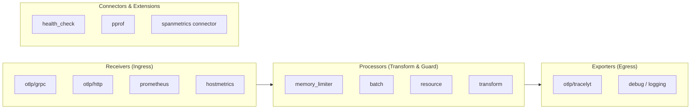

# OpenTelemetry Collector Architecture

This document defines the architecture, pipeline topology, and component model for OpenTelemetry Collectors deployed to bridge external workloads into Tracelyt.

---

## 1. Collector Pipeline Components

An OpenTelemetry Collector pipeline processes telemetry through sequential stages:

### Component Roles
- **Receivers**: Ingest telemetry into the collector from external networks or local files (e.g., `otlp` receiver on ports 4317/4318, `hostmetrics` for system telemetry).
- **Processors**: Apply in-flight transformations:
  - `memory_limiter`: Mandatory first processor to drop data or backpressure if memory breaches thresholds.
  - `batch`: Groups telemetry into efficient multi-record batches to optimize network utilization.
  - `resource`: Injects environment and tenant metadata (`tracelyt.project.id`).
- **Exporters**: Transmit processed telemetry to `tracelyt-ingestion` using standard OTLP/gRPC with TLS.
- **Connectors**: Route data between two pipelines (e.g., computing metric aggregates from spans using `spanmetrics`).
- **Extensions**: Provide operational health checks (`health_check` on port 13133), z-pages, and diagnostic pprof endpoints.

---

## 2. Collector Distribution Strategy

Tracelyt integrations distinguish between two primary upstream distributions:
1. **OpenTelemetry Collector Core**: Minimal, official distribution containing standard OTLP receivers, batch processors, and OTLP exporters.
2. **OpenTelemetry Collector Contrib**: Community-extended distribution containing database receivers (MySQL, MongoDB), cloud monitors, and advanced transformation processors.

> **Guidance Rule**: Integration guides must explicitly state whether an integration requires `otelcol-contrib` or if standard `otelcol` core is sufficient.

---

## 3. Related Documentation

- [OpenTelemetry Strategy](opentelemetry-strategy.md)
- [Telemetry Flow](telemetry-flow.md)
- [Configuration Conventions](../standards/configuration-conventions.md)
