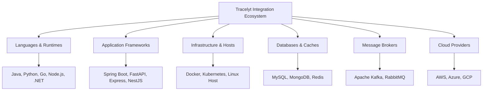

# Integration Categories and Classification

This document establishes the classification taxonomy for technologies evaluated and integrated within **Tracelyt Integrations**.

---

## 1. Classification Matrix

---

## 2. Category Deep-Dives

### 2.1 Language Integrations
- **Scope**: Java, Python, Go, Node.js, and .NET runtime environments.
- **Guidance Delivered**:
  - Selection between automatic instrumentation (bytecode agents, monkey-patching) and manual SDK instrumentation.
  - Resource attribute configuration (`service.name`, `service.version`, `deployment.environment`).
  - W3C Trace Context propagation across HTTP and gRPC boundaries.
  - Environment variable standards (`OTEL_EXPORTER_OTLP_ENDPOINT`, `OTEL_SERVICE_NAME`).

### 2.2 Framework Integrations
- **Scope**: Common enterprise application frameworks:
  - Java: Spring Boot 3.x, Spring MVC.
  - Python: FastAPI, Django, Flask.
  - Node.js: Express.js, NestJS.
  - Go: Standard `net/http`, Gin, Echo.
  - .NET: ASP.NET Core 8.x+.
- **Guidance Delivered**: Framework middleware configuration, route parameter normalization (avoiding high-cardinality URI paths), and exception capture.

### 2.3 OpenTelemetry Collector Integrations
- **Scope**: Deployment patterns for OpenTelemetry Collector (Agent sidecar vs Gateway cluster).
- **Guidance Delivered**: Standard pipelines (receivers, processors, exporters), batching parameters, and memory limiter configurations.

### 2.4 Infrastructure Integrations
- **Scope**: Docker daemon metrics, Kubernetes node/pod telemetry, Linux host metrics (CPU, memory, disk, network via hostmetrics receiver).
- **Guidance Delivered**: DaemonSet configurations, cgroup monitoring permissions, and Kubernetes metadata enrichment.

### 2.5 Database & Cache Integrations
- **Scope**: MySQL, MongoDB, and Redis.
- **Guidance Delivered**:
  - Application-side client instrumentation (tracing query latency and sanitizing query text).
  - Infrastructure-side metric collection (connection pools, cache hit ratios, replication lag).

### 2.6 Messaging Integrations
- **Scope**: Apache Kafka and RabbitMQ.
- **Guidance Delivered**: Header-based trace context injection across producers and consumers, consumer lag metrics, and broker cluster health.

### 2.7 Cloud Provider Integrations
- **Scope**: AWS, Microsoft Azure, and Google Cloud Platform.
- **Guidance Delivered**: IAM role configurations, CloudWatch / Azure Monitor metric scraping, and managed container service instrumentation (ECS, EKS, Cloud Run).

---

## 3. Related Documentation

- [OpenTelemetry Strategy](opentelemetry-strategy.md)
- [System Boundaries](system-boundaries.md)
- [Standard Integration Guide Template](../templates/integration-guide-template.md)
