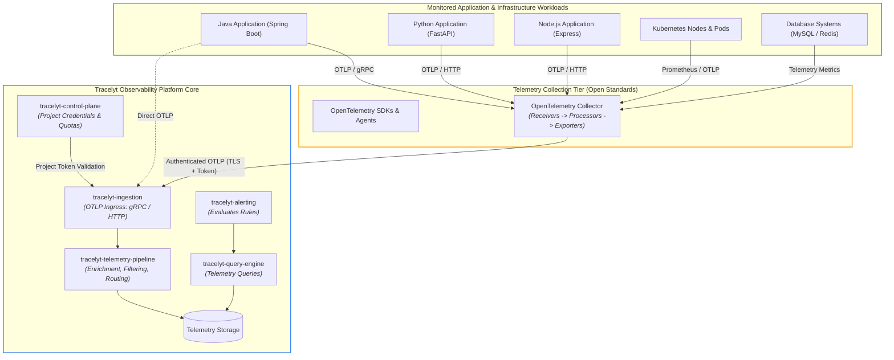

# Integration Architecture Overview

This document describes the role, mission, and architectural placement of **Tracelyt Integrations** within the broader Tracelyt open-source observability platform.

---

## 1. Subsystem Mission

The primary responsibility of `tracelyt-integrations` is to maintain:
1. **Validated Guidance**: Step-by-step documentation on instrumenting applications, frameworks, and infrastructure using open standards.
2. **Standard Collector Configurations**: Curated, secure OpenTelemetry Collector pipeline configurations to bridge third-party telemetry into Tracelyt.
3. **Compatibility Matrices**: Documented, verified matrices matching specific runtime, framework, and collector versions.
4. **Troubleshooting & Best Practices**: Actionable diagnostics for resolving missing telemetry, broken trace contexts, and permission issues.

---

## 2. Platform Integration Architecture

---

## 3. Four Tiers of Integration Terminology

To prevent confusing upstream OpenTelemetry capabilities with Tracelyt-verified assets, the project strictly distinguishes:

1. **Upstream OpenTelemetry Capability**: Functionality supported by upstream OpenTelemetry projects (e.g., OpenTelemetry Java agent supports Spring Boot). This does not imply Tracelyt has tested or validated it.
2. **Tracelyt Integration Documentation**: Documented step-by-step guidance provided in this repository explaining how to configure the integration.
3. **Tracelyt-Validated Integration**: An integration verified against a reproducible test environment with recorded version combinations and documented expected telemetry behavior.
4. **Tracelyt-Maintained Integration**: An integration actively maintained with continuous regression testing and compatibility tracking across upstream releases.

---

## 4. Related Documentation

- [System Boundaries](system-boundaries.md)
- [OpenTelemetry Strategy](opentelemetry-strategy.md)
- [Integration Lifecycle](../standards/integration-lifecycle.md)
