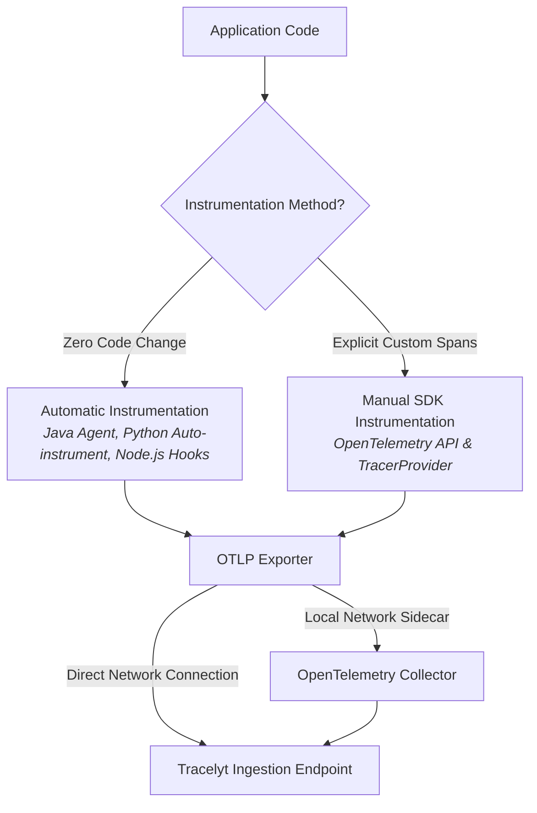

# OpenTelemetry Strategy and Interoperability

This document defines Tracelyt's strategic alignment with the [OpenTelemetry](https://opentelemetry.io/) project, establishing OpenTelemetry as the primary interoperability standard for all Tracelyt integrations.

---

## 1. Standards Alignment

Tracelyt strictly adopts open, vendor-neutral telemetry specifications:

### 1.1 OpenTelemetry Protocol (OTLP)
- All external applications and collectors communicate with Tracelyt over standard **OTLP/gRPC** (default port: `4317`) or **OTLP/HTTP** (default port: `4318`) with Protocol Buffers or JSON serialization.
- Proprietary agent wire protocols are explicitly avoided.

### 1.2 OpenTelemetry Semantic Conventions
- Integrations must adhere to [OpenTelemetry Semantic Conventions](https://opentelemetry.io/docs/specs/semconv/):
  - HTTP spans: `http.request.method`, `http.response.status_code`, `url.path`.
  - Database spans: `db.system`, `db.operation.name`, `db.collection.name`.
  - Resource attributes: `service.name`, `service.version`, `service.instance.id`, `deployment.environment.name`.

### 1.3 Context Propagation
- Distributed context propagation strictly adheres to W3C recommendations:
  - **W3C Trace Context**: Standard `traceparent` and `tracestate` HTTP/message headers.
  - **W3C Baggage**: Optional key-value propagation for business attributes across service boundaries.

---

## 2. Telemetry Signals

Tracelyt processes three fundamental telemetry signals, but does not assume every technology supports all three:

| Signal | Primary Role | Standard Collector Component Examples |
| :--- | :--- | :--- |
| **Traces** | Request-scoped distributed transaction latency, dependency paths, and exception spans. | `otlp` receiver, `batch` processor, `otlp` exporter. |
| **Metrics** | Aggregated time series representing throughput, latency percentiles, error rates, and resource utilization. | `hostmetrics` receiver, `prometheus` receiver, `metricstransform` processor. |
| **Logs** | Discrete event text and structured JSON emissions correlated with active trace IDs. | `filelog` receiver, `journald` receiver, `transform` processor. |

---

## 3. Instrumentation Approaches

1. **Automatic Instrumentation**: Recommended for rapid time-to-value without modifying application codebases (e.g., the OpenTelemetry Java agent jar attached via `-javaagent`).
2. **Manual SDK Instrumentation**: Recommended when custom domain spans, specialized baggage, or fine-grained span attributes are required.
3. **Collector-Mediated Export**: Recommended in enterprise production environments to centralize credential management, perform local batching, and enforce memory limits before egress.

---

## 4. Related Documentation

- [Collector Architecture](collector-architecture.md)
- [Telemetry Flow](telemetry-flow.md)
- [System Boundaries](system-boundaries.md)
