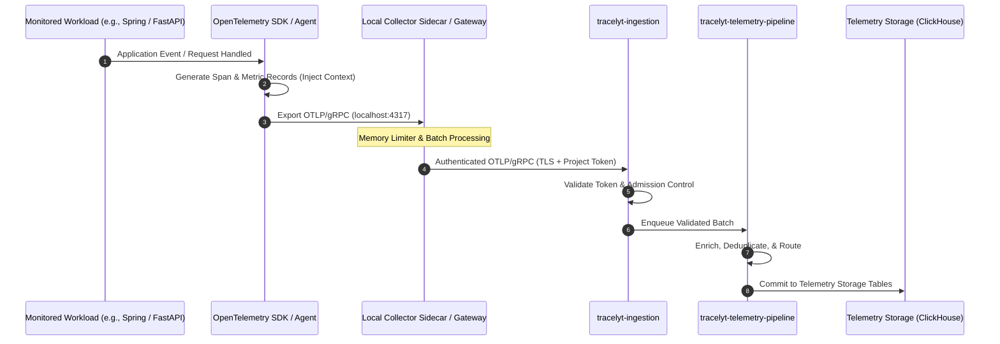

# Telemetry Flow and Ingestion Pipeline

This document describes the end-to-end telemetry flow from monitored customer applications and infrastructure into Tracelyt's backend services.

---

## 1. End-to-End Telemetry Sequence

---

## 2. Ingestion Network Contract

To ensure predictable firewall and routing configuration:
- **Protocol**: OTLP over gRPC (HTTP/2) or OTLP over HTTP (HTTP/1.1 or HTTP/2).
- **Authentication**: Bearer token or custom header (`X-Tracelyt-Project-Token`) validated by `tracelyt-ingestion` against `tracelyt-control-plane`.
- **Encryption**: TLS 1.2 or TLS 1.3 is mandatory for external egress to public Tracelyt endpoints.

---

## 3. Related Documentation

- [OpenTelemetry Strategy](opentelemetry-strategy.md)
- [Collector Architecture](collector-architecture.md)
- [System Boundaries](system-boundaries.md)
