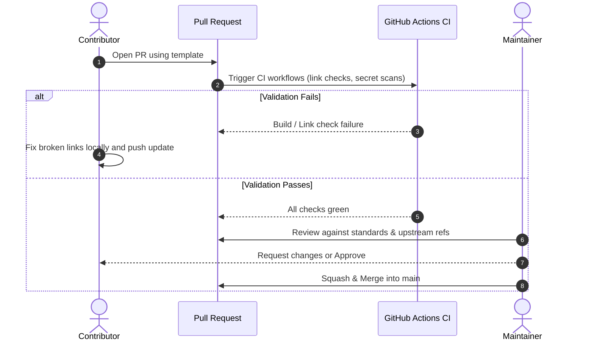

# Contribution Workflow and PR Lifecycle

This document describes the branch conventions, PR lifecycle, and submission criteria for contributing to **Tracelyt Integrations**.

---

## 1. Branching Strategy

- **`main`**: The stable, primary development branch. Direct pushes to `main` are restricted.
- **Feature Branches**: Should branch from `main` and use descriptive prefixes:
  - `docs/add-spring-boot-guide`
  - `integration/fastapi-otel-config`
  - `fix/collector-pipeline-typo`
  - `standards/clarify-collector-limits`

---

## 2. Pull Request Lifecycle

---

## 3. Pull Request Requirements

When submitting an integration PR:
1. Complete all sections of [PULL_REQUEST_TEMPLATE.md](../../.github/PULL_REQUEST_TEMPLATE.md).
2. For new integration guides, verify that all 17 sections of the [Standard Integration Guide Template](../templates/integration-guide-template.md) are present.
3. Verify that all upstream references and software versions are accurate and tested.
4. Run `python tools/validate_docs.py` locally and verify zero errors.

---

## 4. Related Documentation

- [Development Setup](development-setup.md)
- [Review Checklist](review-checklist.md)
- [Maintainers List](../../MAINTAINERS.md)

