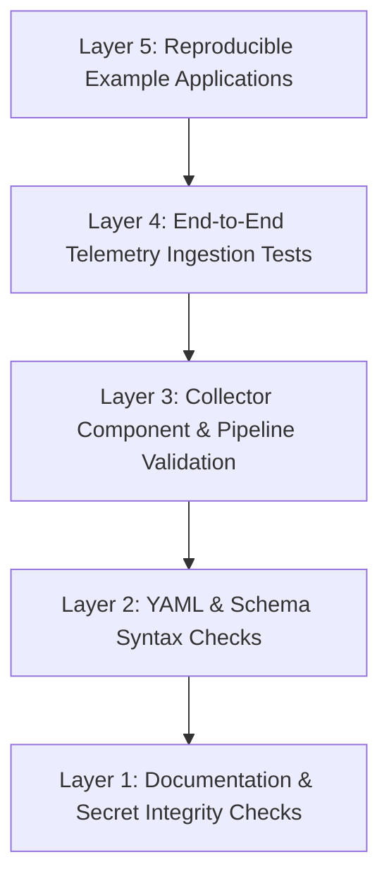

# Integration Testing Guidelines and Verification Framework

This document outlines the testing strategy, validation levels, and quality gates for assets in **Tracelyt Integrations**.

---

## 1. The 5-Layer Integration Testing Pyramid

---

## 2. Validation Layers

### Layer 1: Documentation & Secret Integrity (Active)
- **Scope**: Relative link resolution, Markdown syntax conformance, and regex/entropy scanning for accidentally committed API tokens or credentials.
- **Execution**: Automated in CI via `tools/validate_docs.py`.

### Layer 2: Configuration & Syntax Validation (Planned)
- **Scope**: Verifying that OpenTelemetry Collector YAML manifests adhere to valid syntax and pass `otelcol validate`.
- **Criteria**: Zero syntax errors; all referenced receivers, processors, and exporters exist in the targeted distribution.

### Layer 3: Collector Component Validation (Planned)
- **Scope**: Verifying collector startup in a local containerized environment.
- **Criteria**: Memory limiter processor starts cleanly; health check extension returns HTTP 200 on port 13133.

### Layer 4: Telemetry Ingestion Compatibility (Planned)
- **Scope**: Emitting synthetic spans and metrics to verify that `tracelyt-ingestion` accepts the OTLP payload without rejected data points.
- **Criteria**: Traces conform to OpenTelemetry Semantic Conventions; W3C trace context is preserved.

### Layer 5: Example Application Reproducibility (Planned)
- **Scope**: End-to-end execution of example applications against local collector instances.
- **Criteria**: Zero manual patching required; cleanly stops and removes containers on exit.

---

## 3. Strict Truth-in-Testing Rule

- **No Synthetic Success**: Never create automated tests that return success without actually validating real component or telemetry behavior.
- **No Fabricated Benchmarks**: Do not claim an integration has passed validation unless reproducible test logs and environment specifications are documented.

---

## 4. Related Documentation

- [Review Checklist](review-checklist.md)
- [Integration Lifecycle](../standards/integration-lifecycle.md)
- [Compatibility Policy](../standards/compatibility-policy.md)

