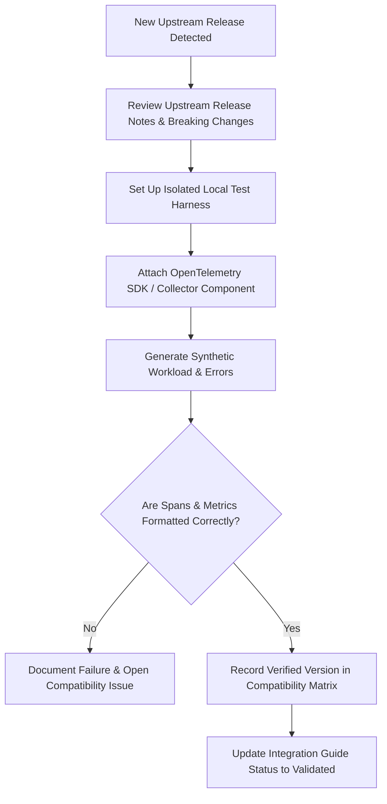

# Compatibility Verification Procedure

This document outlines the standard operational procedure for verifying and recording compatibility for new upstream software releases in **Tracelyt Integrations**.

---

## 1. Upstream Verification Workflow

When an upstream technology (e.g., OpenTelemetry Collector, Spring Boot, FastAPI, MySQL) publishes a new minor or major release:

---

## 2. Verification Checklist

To promote an integration version from `Planned` to `Validated`, the maintainer must verify:
- [ ] Application starts cleanly with the new upstream version without dependency conflicts.
- [ ] Traces capture HTTP route templates rather than un-normalized raw URLs.
- [ ] Exception stack traces are properly mapped into span events.
- [ ] Collector exports OTLP batches without rejected data points.
- [ ] Resource attributes (`service.name`, `telemetry.sdk.version`) are present.
- [ ] The verification date, tested environment, and commit SHA are recorded in the integration guide.

---

## 3. Related Documentation

- [Compatibility Architecture](../architecture/compatibility-architecture.md)
- [Compatibility Policy](../standards/compatibility-policy.md)
- [Integration Lifecycle](../standards/integration-lifecycle.md)

