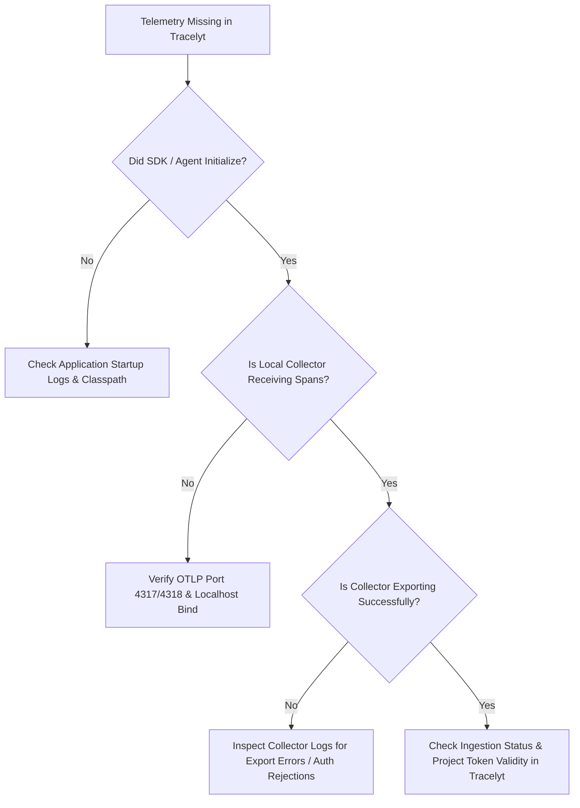

# Troubleshooting Telemetry Integrations

This guide provides structured diagnostic playbooks for diagnosing and resolving common integration issues when connecting workloads to **Tracelyt**.

---

## 1. Missing Telemetry Diagnostic Flow

When an instrumented application runs but no traces or metrics appear in Tracelyt:

### Diagnostic Steps

#### Step 1: Verify Application Agent Initialization
- Look for OpenTelemetry agent banner in application stdout:
  `[otel.javaagent] OpenTelemetry Javaagent version x.y.z initialized.`
- Ensure `-javaagent:/path/to/opentelemetry-javaagent.jar` or Python auto-instrumentation command (`opentelemetry-instrument`) was executed properly.

#### Step 2: Verify Collector Ingress
- Inspect collector metrics on port 8888 (e.g., `curl http://localhost:8888/metrics | grep otelcol_receiver_accepted_spans`).
- Enable temporary collector debug logging by adding `debug` exporter in `otel-config.yaml`.

#### Step 3: Verify Network Egress & Authentication
- If collector logs report HTTP 401 Unauthorized or gRPC `UNAUTHENTICATED`:
  - Verify that `X-Tracelyt-Token` header matches an active project token in `tracelyt-control-plane`.
- If collector logs report connection refused:
  - Check firewall egress on port 4317 (gRPC) or 4318 (HTTP).
  - Verify proxy configuration (`HTTPS_PROXY`).

> **CRITICAL SECURITY RULE**: Never disable TLS certificate verification (`insecure_skip_verify: true`) as a troubleshooting workaround. If certificate errors occur, ensure the correct corporate or custom CA bundle is mounted into the collector container.

---

## 2. Broken Trace Context Propagation

If traces appear fragmented into individual, unlinked spans:
- Verify that downstream HTTP clients and upstream servers use identical context propagation formats (default: W3C Trace Context `traceparent`).
- In asynchronous message queues (Kafka, RabbitMQ), verify that producer instrumentation injects trace context into message headers and consumer instrumentation extracts them.

---

## 3. Related Documentation

- [Network Security](../security/network-security.md)
- [Collector Architecture](../architecture/collector-architecture.md)
- [Telemetry Flow](../architecture/telemetry-flow.md)

