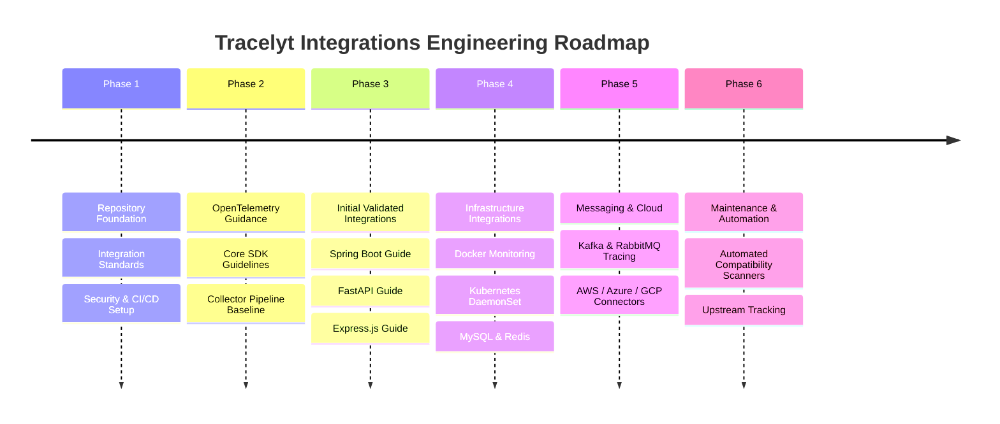

# Development and Evolution Roadmap

This document outlines the phased engineering roadmap for expanding and maintaining **Tracelyt Integrations**.

---

## Roadmap Overview

> **Notice**: Phases are event-driven and contingent upon peer review and architectural approval. No artificial delivery dates are promised.

---

## The 6 Engineering Phases

### Phase 1: Repository Foundation (Current Milestone)
- **Status**: Completed / Current Baseline.
- **Objectives**:
  - Establish a clean, maintainable repository foundation.
  - Comprehensive architectural specifications, OpenTelemetry strategy, and telemetry flow models.
  - Integration standards: 8-stage lifecycle, 17-section template, and compatibility policy.
  - Security architecture covering threat modeling, credential handling, and telemetry privacy.
  - Documentation and secret integrity validation tooling (`tools/validate_docs.py`).
  - GitHub Actions CI workflows with pinned commit SHAs.

---

### Phase 2: OpenTelemetry Guidance
- **Status**: Planned.
- **Objectives**:
  - Publish core language SDK instrumentation guidance (Java, Python, Go, Node.js, .NET).
  - Define recommended OpenTelemetry Collector sidecar and gateway configurations.
  - Document standard resource attribute mappings and semantic convention guidelines.

---

### Phase 3: Initial Validated Integrations
- **Status**: Planned.
- **Objectives**:
  - Implement and validate the first set of framework integration guides:
    - **Java + Spring Boot 3.x**: Auto-instrumentation via OpenTelemetry Java agent.
    - **Python + FastAPI**: Auto-instrumentation and ASGI middleware tracing.
    - **Node.js + Express.js**: OpenTelemetry Node SDK and HTTP instrumentation.
  - Provide verified compatibility matrices and reproducible verification steps for each.

---

### Phase 4: Infrastructure & Database Integrations
- **Status**: Planned.
- **Objectives**:
  - Kubernetes DaemonSet collector configuration for cluster metrics and pod logs.
  - Docker daemon and Linux host metrics collection via `hostmetrics`.
  - Database monitoring guides for MySQL, MongoDB, and Redis with least-privilege credentials.

---

### Phase 5: Messaging & Cloud Integrations
- **Status**: Planned.
- **Objectives**:
  - Apache Kafka producer and consumer trace context propagation guidance.
  - RabbitMQ header injection patterns and queue depth metric collection.
  - Cloud provider telemetry connectors (AWS ECS/EKS, Azure App Services, GCP Cloud Run).

---

### Phase 6: Integration Maintenance & Automation
- **Status**: Planned.
- **Objectives**:
  - Scheduled GitHub Actions workflows to test against newly released upstream SDK and Collector versions.
  - Automated compatibility matrix updates.
  - Deprecation lifecycle management for EOL frameworks.

---

## Related Documentation

- [Integration Overview](../architecture/integration-overview.md)
- [Integration Lifecycle](../standards/integration-lifecycle.md)
- [Compatibility Policy](../standards/compatibility-policy.md)

