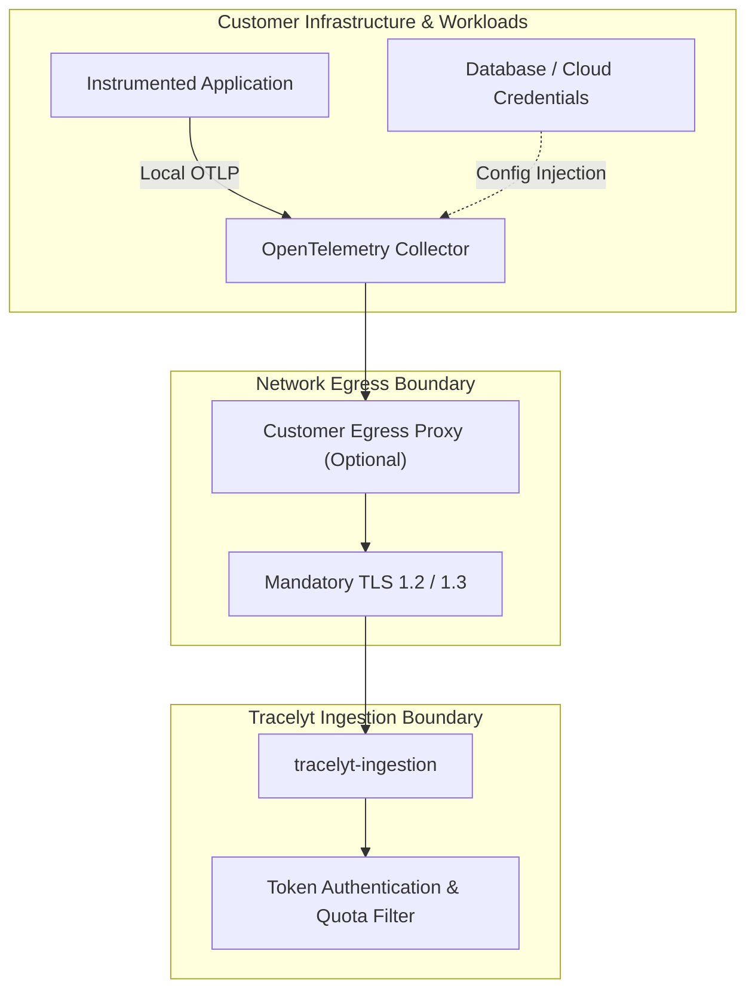

# Integration Threat Model

This document outlines the STRIDE-aligned threat model for integrations connecting external applications, infrastructure, and collectors to **Tracelyt**.

---

## 1. Trust Boundaries and Data Flow

---

## 2. Threat Analysis Matrix (STRIDE)

| ID | STRIDE Category | Threat Scenario | Impact | Mitigation Strategy |
| :--- | :--- | :--- | :--- | :--- |
| **TM-INT-01** | Information Disclosure | **Hardcoded Ingestion Tokens**: Developer commits real Tracelyt project tokens or database passwords in an integration configuration. | Unauthorized ingestion quota consumption; database credential exposure. | Enforce environment variable expansion (`${env:TOKEN}`); automated secret scanner in CI (`tools/validate_docs.py`). |
| **TM-INT-02** | Information Disclosure | **Man-in-the-Middle (MitM) Interception**: Collector exports telemetry over plaintext HTTP/gRPC without TLS across public internet. | Telemetry sniffing; interception of application error logs and metadata. | Mandatory TLS 1.2/1.3 with certificate validation; plain HTTP rejected by ingestion gateways in production. |
| **TM-INT-03** | Spoofing | **Telemetry Forgery**: Malicious actor sends fake spans with spoofed `service.name` to corrupt service dependency graphs. | Corrupted observability data; false alert firing. | Mandatory project authentication token on all OTLP ingress endpoints. |
| **TM-INT-04** | Elevation of Privilege | **Excessive Database Permissions**: Database metric receiver configured with `SUPERUSER` or `root` credentials. | Database compromise if collector container is breached. | Enforce least-privilege read-only monitoring accounts (e.g., MySQL `PROCESS`, `REPLICATION CLIENT` only). |
| **TM-INT-05** | Information Disclosure | **PII in Span Attributes**: HTTP instrumentation automatically attaches raw query parameters containing user passwords or PII. | Regulatory non-compliance (GDPR, CCPA). | Collector `transform` or `attributes` processor scrubbing sensitive query keys before export. |
| **TM-INT-06** | Denial of Service | **Collector Memory Exhaustion**: Massive traffic spike causes in-memory collector queue to grow unbounded until killed by OOM killer. | Loss of telemetry; host system memory starvation. | Enforce `memory_limiter` processor as the first processor in all collector pipelines. |

---

## 3. Related Documentation

- [Credential Handling](credential-handling.md)
- [Network Security](network-security.md)
- [Telemetry Data Privacy](telemetry-data-privacy.md)
