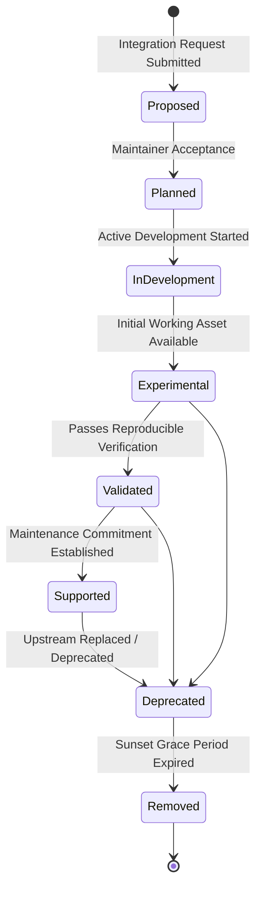

# Integration Lifecycle and Maturity Model

This document defines the 8-stage lifecycle through which integrations are proposed, implemented, verified, maintained, and retired within **Tracelyt Integrations**.

---

## 1. Lifecycle State Machine

---

## 2. Lifecycle Stage Definitions

| Status | Definition | Acceptance / Promotion Criteria |
| :--- | :--- | :--- |
| **Proposed** | Under consideration by maintainers and community. | Initial GitHub issue submitted with target technology and upstream references. |
| **Planned** | Accepted as an official roadmap objective. | Approved by at least one maintainer; architectural category assigned. |
| **In Development** | Implementation of guide or configuration is actively underway. | Pull Request opened adhering to guide template. |
| **Experimental** | Draft guide or configuration available for early community testing. | Passes static syntax checks; limitations explicitly documented. |
| **Validated** | Tested against documented compatibility matrix in reproducible environment. | Upstream version identified, telemetry signals verified, security reviewed. |
| **Supported** | Actively maintained with continuous regression testing and SLA commitment. | Continuous test automation running; maintainer committed to CVE triage. |
| **Deprecated** | Integration being phased out due to upstream deprecation or superior alternatives. | Sunset notice published; deprecation timeline announced (min 90 days). |
| **Removed** | Integration assets removed from active repository branch. | Deprecation grace period expired; archived in release tags. |

---

## 3. Strict Promotion Rule

- No integration may be marked `Validated` or `Supported` in its documentation header or README without attaching verifiable, reproducible validation evidence.

---

## 4. Related Documentation

- [Compatibility Policy](compatibility-policy.md)
- [Testing Guidelines](../development/testing-guidelines.md)
- [Integration Documentation Standard](integration-documentation.md)
